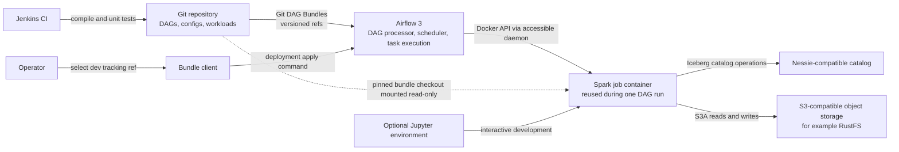

# Open Source Lakehouse Workloads

This repository contains environment-configured PySpark workloads and Airflow DAGs for a lakehouse using Apache Iceberg, a Nessie-compatible catalog, and S3-compatible object storage. Airflow reads versioned code from Git DAG Bundles and runs Spark jobs in Docker containers. Jenkins checks changes; it does not deploy or copy workload files into Airflow.

## Architecture



For each DAG run, Airflow validates the selected environment config, starts a Spark container, and mounts the same pinned bundle revision into it. Each workload is submitted as a separate `spark-submit` application. The DAG's `runs_after` declarations define ordering and parallel branches. A cleanup task removes the container after the workload tasks finish, including when a task fails.

The Spark setup currently uses `local[*]` inside one container. It does not provision a distributed Spark master and worker cluster. Jupyter is optional for interactive development; production execution is driven by Airflow.

## Infrastructure required

| Component | Requirement |
|---|---|
| Git hosting | Repository reachable by Airflow's Git DAG Bundle provider. The DAGs, config, and workload files must live in the same selected ref. |
| Airflow | Airflow 3 deployment with compatible Git DAG Bundle support and configured bundle refresh/versioning. DAG processor, scheduler, and task execution components need the required provider/runtime dependencies. |
| Bundle configuration | Three stable bundle names: `lakehouse-dev` tracks an operator-selected feature ref, `lakehouse-uat` tracks `uat`, and `lakehouse-prod` tracks `main`. Git authentication belongs in an Airflow connection or secrets backend. |
| Docker access | The Airflow task execution environment needs the Docker SDK and access to a Docker daemon. The daemon must be able to see and mount the exact bundle checkout path passed by the task runner. Configure its endpoint and any shared Docker network. |
| Spark job image | A Docker image with a compatible Spark/PySpark runtime, Iceberg and Nessie catalog integrations, S3A support, PyYAML, and the dependencies needed by the workloads. The image must be available to the Docker daemon. |
| Catalog | A reachable Nessie-compatible catalog configured in the Spark runtime, with the namespaces and Iceberg tables addressed by the workload configs. |
| Object storage | Reachable S3-compatible storage with a bucket/path matching `storage_path`, S3A support, and permissions for the Spark job identity. Configure the region and credentials through the runtime or an approved secret mechanism. |
| CI | Jenkins or an equivalent CI runner with Python and the repository development dependencies to run compilation and unit tests. CI is not a deployment mechanism. |
| Optional notebook environment | Jupyter with the Spark dependencies and network access to the same catalog and storage for interactive workload development. The included helper selects `dev` by default. |

The sample DAG reads these Airflow environment settings:

- `LAKEHOUSE_SPARK_IMAGE` (default: `airflow-spark-job:3.5.5_1.8.1`)
- `LAKEHOUSE_SPARK_MASTER` (default: `local[*]`)
- `LAKEHOUSE_DOCKER_URL` (default: `unix://var/run/docker.sock`)
- `LAKEHOUSE_SPARK_DOCKER_NETWORK` (optional Docker network)
- `AWS_REGION` (default: `us-east-1`)

Catalog endpoints, storage credentials, Git credentials, and deployment-specific bundle reload settings must be supplied by the platform. Do not commit secrets. The YAML files in `configs/` are examples and must point to the intended environment targets before running jobs; in particular, the UAT file calls out that its values are placeholders.

## Environment and bundle selection

The repository keeps one non-secret YAML file per environment:

- `configs/dev.yml`
- `configs/uat.yml`
- `configs/prod.yml`

Each contains `storage_path` and `database_name`. The shared loader validates these required keys and makes additional YAML settings available to workloads. It rejects unsupported environment names instead of silently falling back to another config.

The Git ref determines which version of DAGs, configs, and Spark code Airflow loads. The stable bundle name determines the runtime environment and DAG ID prefix:

| Bundle name | Config | DAG ID prefix | Intended ref |
|---|---|---|---|
| `lakehouse-dev` | `dev.yml` | `dev-` | Operator-selected feature branch |
| `lakehouse-uat` | `uat.yml` | `uat-` | `uat` |
| `lakehouse-prod` or `lakehouse-main` | `prod.yml` | `main-` | `main` |

Changing the dev tracking ref lets an operator test a feature branch while retaining the dev config and DAG identity. Each DAG run uses its recorded bundle commit so its DAG, config, helpers, and workload code stay aligned. See [AIRFLOW_BUNDLES.md](AIRFLOW_BUNDLES.md) for setup, branch selection, and operational checks.

## Solution design principles

- **Keep environment settings out of workload code.** Environment YAML holds non-secret paths, database names, and other workload settings. Credentials and tokens come from the platform's connections or secrets backend.
- **Version code and configuration together.** DAG Bundles provide a pinned repository revision for every run, avoiding mismatches between DAG definitions and Spark entrypoints.
- **Keep DAG declarations small and reusable.** A declaration supplies a DAG name, schedule, and workload/task mappings. The shared DAG factory handles environment selection, config validation, Spark container lifecycle, submissions, dependencies, and cleanup.
- **Make dependencies explicit.** Workloads without `runs_after` start independently after container creation. Named predecessors describe the DAG graph and permit parallel execution where dependencies allow it.
- **Reuse runtime setup within a DAG run.** One Spark container receives the read-only bundle mount; multiple entrypoints run as separate Spark applications inside it.
- **Keep workloads portable.** Spark jobs are Python files in Jupytext `py:percent` format. They support `spark-submit` and can be opened as notebooks; Jupyter-specific initialization is isolated in a helper.
- **Limit side effects.** The environment initializer creates the configured namespace if missing and writes only the dedicated sample Iceberg table. Iceberg/Nessie garbage collection remains a platform operation because deleting files without reference-aware GC can affect other branches or historical snapshots.
- **Separate CI from release control.** Jenkins compiles code and runs tests. Airflow's bundle configuration and the operator client control which branch Airflow reads; no file-copy publisher is used.
- **Treat branch switching as privileged.** Feature-branch code runs with Airflow/Spark capabilities, so only trusted operators should change the dev bundle ref.

## Repository layout

```text
configs/                    Per-environment YAML settings
dags/                       Thin DAG declarations and shared DAG factory
notebooks/common/            Config loading, CLI parsing, Spark bootstrap
notebooks/workload/          Jupytext-compatible Spark workload scripts
tests/                       Unit and property tests
airflow_bundle_client.py     Operator CLI for selecting the dev Git ref
airflow_bundle_config.example.json
                            Secret-free Airflow Git bundle example
Jenkinsfile                 Compile and test CI pipeline
AIRFLOW_BUNDLES.md           Bundle setup and operations guide
```

## Local development and checks

Install the development dependencies and run the repository checks:

```bash
python3 -m pip install -r requirements-dev.txt
python3 -m compileall -q airflow_bundle_client.py dags notebooks
python3 -m pytest -q
```

The Spark workloads require access to a compatible Spark runtime, catalog, and object store to run end to end. Unit tests do not replace deployment validation of Airflow DAG parsing, bundle checkout mounts, Spark dependencies, catalog connectivity, or storage permissions.

## Further documentation

- [Airflow Git DAG Bundles](AIRFLOW_BUNDLES.md)
- [AI-DLC design records](aidlc-docs/knowledge/opensource-lakehouse/application-design.md)
