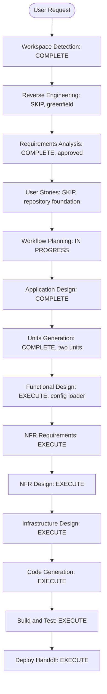

# Execution Plan

## Detailed Analysis Summary

### Change Impact Assessment
- **User-facing changes**: No end-user UI. The changes support data engineers and repository maintainers.
- **Structural changes**: Yes. Introduces the Airflow/Spark/Jenkins repository layout and replaces the Databricks-specific repository conventions.
- **Data model changes**: No application data model changes. Adds configuration keys `storage_path` and `database_name` per environment.
- **API changes**: No application API changes.
- **NFR impact**: Yes. Jenkins credentials and deployment destinations must be externalized; branch behavior and missing-target failures must be clear.
- **Affected areas**: `AGENTS.md`, `configs/`, `notebooks/`, `dags/`, Jenkins pipeline configuration, and canonical application design.

### Risk Assessment
- **Risk Level**: Medium. The repository is greenfield, but Jenkins must deploy to external Airflow instances and a separately managed Spark cluster.
- **Rollback Complexity**: Easy for repository changes; deployment rollback depends on the external Jenkins/Airflow setup.
- **Testing Complexity**: Moderate. YAML, DAG references, Jenkins syntax, and branch mapping can be checked locally; end-to-end deployment requires external systems.
- **Known deployment inputs**: Airflow deployment endpoint, Docker daemon endpoint, Spark image/master/network, and Jenkins credential identifiers have not been supplied. Keep these external to source and do not invent values.
- **Deployment approach assumption for approval**: Implement a Jenkins pipeline with a configurable sync/deploy step and environment targets. The concrete transport can use Jenkins-managed parameters/credentials; if a specific Airflow deployment transport is required, capture it as an input before wiring that step to a live target.

## Workflow Visualization

### Mermaid Diagram

### Text Alternative
- INCEPTION: Workspace Detection complete; Reverse Engineering skipped; Requirements Analysis and Workflow Planning approved; User Stories skipped; Application Design and two-unit Units Generation complete.
- CONSTRUCTION: Functional Design executes for configuration loading and validation; NFR Requirements, NFR Design, Infrastructure Design, Code Generation, and Build and Test execute.
- DEPLOY: Prepare the PR request and deployment handoff after Build and Test approval; do not deploy to external environments.

## Phases to Execute

### INCEPTION PHASE
- [x] Workspace Detection (greenfield repository).
- [x] Reverse Engineering skipped (no existing application code).
- [x] Requirements Analysis (approved; includes the requested per-environment YAML fields).
- [x] User Stories skipped (infrastructure and developer tooling change with no end-user workflow or multiple personas).
- [x] Workflow Planning (revised plan approved by user).
- [x] Application Design - **COMPLETE**.
  - **Rationale**: Establish and document the new Airflow, Spark, configuration, and Jenkins deployment architecture as the canonical project baseline.
- [x] Units Generation - **EXECUTE, COMPLETE**.
  - **Rationale**: NFR Requirements requires a completed Functional Design, and Functional Design requires unit-of-work artifacts. Generate one cohesive unit covering config, Spark workload, DAG, and Jenkins pipeline rather than independent packages.

### CONSTRUCTION PHASE
- [ ] Functional Design - **EXECUTE**.
  - **Rationale**: Define the shared configuration loader's validation behavior and its contract before NFR Requirements. The Spark sample has no domain transformations.
- [ ] NFR Requirements - **EXECUTE**.
  - **Rationale**: Define secret handling, missing deployment configuration behavior, and operational validation. Property-Based Testing is enabled; select an appropriate Python framework only if the generated code contains testable properties, otherwise document the applicable PBT rules as N/A.
- [ ] NFR Design - **EXECUTE**.
  - **Rationale**: Carry external credential handling and configuration validation into the Jenkins, Airflow, and Spark design.
- [ ] Infrastructure Design - **EXECUTE**.
  - **Rationale**: Map the Jenkins branch pipeline to the Airflow deployments and separately managed Spark cluster while keeping unknown target values configurable.
- [ ] Code Generation - **EXECUTE (ALWAYS)**.
  - **Rationale**: Create environment YAML examples, sample Spark script, sample DAG, Jenkins pipeline, and updated repository guide.
- [ ] Build and Test - **EXECUTE (ALWAYS)**.
  - **Rationale**: Prepare build and verification instructions for YAML, pipeline syntax, DAG imports/references, and branch mapping. External deployment validation depends on the user's Jenkins/Airflow/Spark infrastructure.

### DEPLOY PHASE
- [ ] Deploy - **EXECUTE (ALWAYS)**.
  - **Rationale**: Prepare a PR request and ordered operational handoff. This stage does not trigger Jenkins or deploy to Airflow.

## Canonical Knowledge Impact Inventory

| Canonical path | Action | Requirement and owning component | Reason / new-boundary justification |
|---|---|---|---|
| `aidlc-docs/knowledge/opensource-lakehouse/application-design.md` | CREATE | FR-1 through FR-5; project-level Airflow/Spark/Jenkins repository architecture | This greenfield project has no existing canonical design. A project-level design is needed to preserve the approved orchestrator, workload, configuration, and branch deployment conventions. |
| `aidlc-docs/knowledge/opensource-lakehouse/functional-design/configuration-loader.md` | CREATE | FR-1 and FR-2; shared configuration loader component | The approved Application Design establishes a reusable loader with validation behavior used by both DAG and Spark workload. A canonical component design will preserve its stable contract and validation rules. |

No existing functional-design documents or workload indexes are present.

## Coordination and Dependencies
- **Update approach**: One cohesive repository change; no multi-package dependency sequence.
- **Order**: Define the canonical architecture and infrastructure assumptions, then generate configs/workload/DAG/pipeline together so references stay aligned, then prepare verification and deployment handoff documents.
- **External coordination**: Jenkins must provide separate UAT and production Airflow targets and credentials; the Airflow deployments must have a compatible Spark submission connection. Those values are runtime setup inputs, not checked-in values.

## Estimated Timeline
- **Stages in this plan**: 8 remaining stages after revised plan approval (Units Generation, Functional Design, NFR Requirements, NFR Design, Infrastructure Design, Code Generation, Build and Test, and Deploy handoff).
- **Estimated duration**: Not estimated; external deployment details and review turnaround are not known.

## Success Criteria
- **Primary Goal**: A reviewable repository foundation for Airflow-orchestrated Python Spark workloads across `dev`, `uat`, and `prod`.
- **Key Deliverables**: Canonical application design; `configs/dev.yml`, `configs/uat.yml`, `configs/prod.yml` with `storage_path` and `database_name`; sample `.py` workload; DockerOperator DAGs using `spark-submit`; Jenkins branch pipeline; updated `AGENTS.md`; build/test and deployment handoff documents.
- **Quality Gates**: No secrets checked in; branch mapping is `main` to production and `uat` to UAT; artifact paths are consistent; external target values are configurable; workflow stages are reviewed at their AIDLC approval gates.

## Change Plan Addendum: Idempotent Environment Initialization

This addendum scopes the approved workload enhancement without changing the existing Git bundle/deployment architecture or the separate `jenkins-deployment` component. It supersedes the sample-workload behavior and file-name assumptions below for this change only.

### Detailed Analysis Summary
- **User request**: Rename the sample Spark workload to `init_environment` and initialize missing databases and data paths.
- **Clarified behavior**: Create the configured Nessie namespace and object-store prefix idempotently, then retain the dedicated `sample_spark_job_output` overwrite as a smoke test.
- **Scope**: Existing `workload-foundation` component; workload source, branch-selected DAG identity/task names, tests, repository guidance, and active design/code-generation summary.
- **User-facing impact**: No end-user interface. Data engineers get a manual environment initialization DAG/job.
- **Structural impact**: Rename workload source and DAG/job-facing names; repository root layout and bundle paths remain unchanged.
- **Data model impact**: No business schema change. Initialization creates the configured Nessie namespace; the existing smoke-test table remains unchanged.
- **API impact**: No external API or configuration schema change.
- **NFR impact**: Idempotence and safe scope are required. Existing namespaces/prefixes must be accepted; unrelated paths/tables must not be modified.

### Risk Assessment
- **Risk level**: Medium — the job mutates catalog and object-store state, but uses `IF NOT EXISTS`, creates only the configured root prefix, and overwrites only the dedicated smoke-test table.
- **Rollback complexity**: Easy for repository code; created namespace/prefix may be retained without affecting unrelated data.
- **Testing complexity**: Moderate — use a model-backed fake Spark/filesystem for repeat-run properties and example checks; live Nessie/RustFS execution remains an external integration check.

### Workflow Visualization

```mermaid
flowchart TD
    Start([Initialization Job Change]) --> WD[Workspace Detection: COMPLETE]
    WD --> RE[Reverse Engineering: SKIP]
    RE --> RA[Requirements: COMPLETE AND APPROVED]
    RA --> WP[Workflow Planning: REVIEW]
    WP --> US[User Stories: SKIP]
    US --> AD[Application Design: SKIP]
    AD --> UG[Units Generation: SKIP]
    UG --> FD[Functional Design: EXECUTE]
    FD --> NR[NFR Requirements: SKIP]
    NR --> ND[NFR Design: SKIP]
    ND --> ID[Infrastructure Design: SKIP]
    ID --> CG[Code Generation: EXECUTE]
    CG --> BT[Build and Test: EXECUTE]
    BT --> DP[Deploy Handoff: EXECUTE]
    DP --> End([Complete])
    style Start fill:#CE93D8,stroke:#6A1B9A,stroke-width:3px,color:#000
    style End fill:#CE93D8,stroke:#6A1B9A,stroke-width:3px,color:#000
    style WD fill:#4CAF50,stroke:#1B5E20,stroke-width:3px,color:#fff
    style RE fill:#BDBDBD,stroke:#424242,stroke-width:2px,stroke-dasharray:5 5,color:#000
    style RA fill:#4CAF50,stroke:#1B5E20,stroke-width:3px,color:#fff
    style WP fill:#FFA726,stroke:#E65100,stroke-width:3px,stroke-dasharray:5 5,color:#000
    style US fill:#BDBDBD,stroke:#424242,stroke-width:2px,stroke-dasharray:5 5,color:#000
    style AD fill:#BDBDBD,stroke:#424242,stroke-width:2px,stroke-dasharray:5 5,color:#000
    style UG fill:#BDBDBD,stroke:#424242,stroke-width:2px,stroke-dasharray:5 5,color:#000
    style FD fill:#FFA726,stroke:#E65100,stroke-width:3px,stroke-dasharray:5 5,color:#000
    style NR fill:#BDBDBD,stroke:#424242,stroke-width:2px,stroke-dasharray:5 5,color:#000
    style ND fill:#BDBDBD,stroke:#424242,stroke-width:2px,stroke-dasharray:5 5,color:#000
    style ID fill:#BDBDBD,stroke:#424242,stroke-width:2px,stroke-dasharray:5 5,color:#000
    style CG fill:#4CAF50,stroke:#1B5E20,stroke-width:3px,color:#fff
    style BT fill:#4CAF50,stroke:#1B5E20,stroke-width:3px,color:#fff
    style DP fill:#4CAF50,stroke:#1B5E20,stroke-width:3px,color:#fff
    linkStyle default stroke:#333,stroke-width:2px
```

Text alternative: Requirements and Workflow Planning are approved. Functional Design is approved, and Code Generation is prepared for review. After Code Generation approval, run Build and Test, then prepare the deployment handoff. Reverse Engineering, User Stories, Application Design, Units Generation, NFR stages, and Infrastructure Design are skipped because the change remains within an established component and uses the existing runtime and integrations.

### Phases for This Change

#### Inception
- [x] Requirements Analysis — amendment approved; option B retains the sample-table smoke write.
- [x] Workflow Planning — initialization-change addendum approved; Functional Design follows.
- [ ] User Stories — SKIP; the change is a developer-operated workload with no new user journey or persona.
- [ ] Application Design — SKIP; no new component or service is introduced.
- [ ] Units Generation — SKIP; the existing `workload-foundation` unit owns all changed files.

#### Construction
- [x] Functional Design — EXECUTE; initialization behavior and testable properties approved.
- [ ] NFR Requirements — SKIP; existing secret and operational requirements suffice; the approved change adds no new performance/security target.
- [ ] NFR Design — SKIP; existing safety patterns (`IF NOT EXISTS`, scoped prefix, dedicated overwrite target) address the change.
- [ ] Infrastructure Design — SKIP; Nessie, the Spark runtime, and S3-compatible storage remain the existing integrations.
- [x] Code Generation — EXECUTE; workload, DAG, shared DAG defaults, tests, guidance, bundle-name environment mapping, and summary updates generated and approved.
- [x] Build and Test — EXECUTE; compile validation passed, 48 tests passed, and Airflow parse limitations are documented for review.

#### Deploy
- [x] Deploy Handoff — EXECUTE; proposed PR request now covers the full solution (environment configs, generic loader/CLI, Spark workload, Airflow Git Bundles/client, Jenkins CI, tests, and guidance) with ordered, conditional Airflow handoff; user approved. Intent closure requires its own approval. No PR, push, or deployment performed.

### Canonical Knowledge Impact Inventory
| Canonical path | Action | Requirement and owning component | Reason |
|---|---|---|---|
| `aidlc-docs/knowledge/opensource-lakehouse/application-design.md` | RETAIN (absent) | Project architecture; no architecture requirement changes | No canonical application-design file exists; this change adds no component boundary, so no new project design is created solely for it. |
| `aidlc-docs/knowledge/opensource-lakehouse/functional-design/workload-foundation.md` | CREATE | Initialization and smoke-test behavior; existing `workload-foundation` component | No canonical functional-design file exists. Create the canonical record for the modified component contract and its idempotence/safety properties. |
| `aidlc-docs/knowledge/opensource-lakehouse/functional-design/jenkins-deployment.md` | RETAIN (absent) | Jenkins/bundle deployment component; unrelated to this requirement | No canonical deployment design exists and the deployment component is unchanged. |
| `aidlc-docs/current/construction/workload-foundation/functional-design/business-rules.md` | UPDATE | Namespace/prefix initialization plus sample table; workload component | Active functional design currently requires external namespace/path provisioning and must match the approved behavior. |
| `aidlc-docs/current/construction/workload-foundation/functional-design/business-logic-model.md` | UPDATE | Initialization sequence and smoke write; workload component | Active logic model must describe the new ordered, repeatable initialization flow. |
| `aidlc-docs/current/construction/workload-foundation/code/code-generation-summary.md` | UPDATE | Workload path/name and runtime behavior; workload component | Summary must match generated code and clarify the existing Nessie/S3 runtime assumptions. |

### Code Generation and Test Traceability
- **Approved requirement**: `requirements.md`, “Change Request: Idempotent Environment Initialization”; NFR-5.
- **Workload**: Create the namespace with `CREATE NAMESPACE IF NOT EXISTS`; let the dedicated table write create its object prefix without deleting existing content; then overwrite only `sample_spark_job_output` under its dedicated child path.
- **DAG**: Keep one root `dags/` path, rename the DAG ID/task/job-facing labels and Spark script argument to `init_environment`, and derive environment/config and DAG ID prefix from the Airflow bundle name.
- **PBT**: PBT-01/04 — generate valid environment configs and model catalog/table state; applying initialization repeatedly must preserve the namespace and dedicated-table contract. Example tests pin the `IF NOT EXISTS` command and smoke-table path/write mode. PBT-07 constrains generated identifiers and valid object-store URIs; PBT-08 retains the configured Hypothesis seed and shrinking; PBT-10 keeps example and property tests complementary. PBT-02 and PBT-05 are N/A (no inverse operation/reference algorithm). PBT-06 is N/A for in-process state (the only state is external catalog state modeled in tests).
- **Out of scope**: Provisioning RustFS/Nessie or credentials, changing environment targets, modifying the generic config loader, or changing bundle/deployment policy.

### Success Criteria
- The renamed job creates a missing namespace and accepts an existing namespace on repeated runs; the table write creates the object prefix.
- It retains the deterministic sample write and confines overwrite to the dedicated output table/path.
- DAG, workload, tests, `AGENTS.md`, active design artifacts, canonical functional design, and code-generation summary agree on the names and behavior.
- Local compile and unit checks pass; live Airflow parse and Spark/Nessie/storage verification limitations are recorded without claiming they passed.
