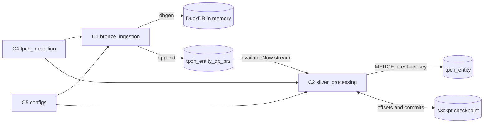

# Component Dependencies — TPC-H Medallion Subproject

## Matrix
| From \ To | C5 configs | C6 helpers | DuckDB | Bronze table | Silver table | Checkpoint |
|---|---|---|---|---|---|---|
| C1 bronze | reads | uses | generates | creates, appends | — | — |
| C2 silver | reads | uses | — | streams | creates, merges | reads, writes, resets |
| C4 workflow | — | — | — | — | — | — |

C4 names C1 and C2 as entry points; the platform runs them.

## Data flow

Text alternative: the workflow runs the bronze notebook and then the silver notebook for each entity. Bronze generates rows with DuckDB in memory and appends them to the bronze table. Silver streams the bronze table's new snapshots, keeps its position in the `s3ckpt://` checkpoint, and merges the latest row per key into the silver table. Both notebooks build names and locations from the configs.

## Coupling notes
- C2 depends on C1's schema (entity columns plus `bronze_ingestion_timestamp`); a bronze schema change needs a silver change.
- Bronze and silver of one entity are coupled only through the bronze table and the checkpoint; entities are independent.
- The platform contract used: `start_spark_job`, `parse_task_args`, Polaris tables at explicit locations, `s3ckpt://` checkpoints (`lakehouse_spark`).
