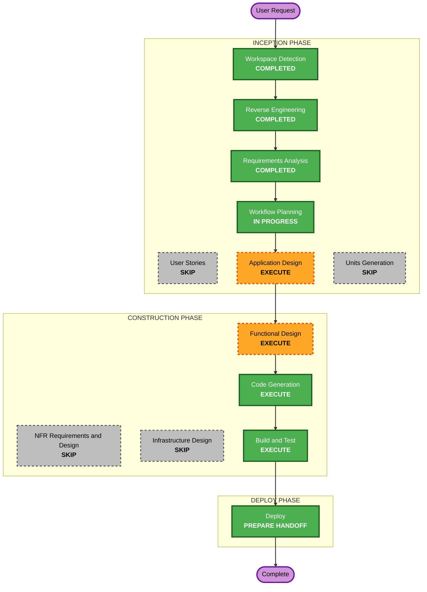

# Execution Plan — TPC-H Medallion Subproject

## Detailed Analysis Summary
- **Transformation type**: a new subproject (two notebooks, one workflow, config keys) plus documentation of conventions; no platform change planned.
- **Impact**: new Iceberg tables in each environment's namespace (`tpch_<entity>_db_brz`, `tpch_<entity>`); a new DAG `default-<env>-tpch_medallion`; `configs/*.yml` gain `checkpoint_path`; AGENTS.md, README and the notebook-structure test change; `sample` is unchanged.
- **Risk**: medium.
  - **Not yet proven** (Application Design probes):
    - writing a Spark checkpoint at `checkpoint_path` (`s3a://` in the product bucket) from an Airflow run and from Jupyter, without credentials beyond Polaris';
    - Iceberg's streaming source on the bronze table through Polaris (`trigger(availableNow=True)`, starting from a timestamp for the lookback);
    - creating an Iceberg table with an explicit location inside the namespace, and `MERGE INTO` it, as the product writer;
    - DuckDB rows (Arrow) into a Spark DataFrame in the run container.
  - **Effects**: tables can't be dropped by the writer; a wrong schema would need an owner or Polaris to fix.
- **Rollback**: revert the commits; created tables stay (writers can't drop them).

## Workflow Visualization

Text alternative: Workspace Detection, Reverse Engineering and Requirements Analysis are completed. Workflow Planning leads to Application Design, Functional Design, Code Generation, Build and Test, and the Deploy handoff. User Stories, Units Generation, NFR and Infrastructure Design are skipped.

## Phases
- [ ] User Stories: SKIP. One persona (the data engineer); the requirements state the behavior.
- [ ] Application Design: **EXECUTE**. The four probes above (in dev, as the platform's writer path allows, and in throwaway sessions); notebook components and their sections; how the checkpoint location, table locations and names are derived; the widget and argument declarations.
- [ ] Units Generation: SKIP. One unit, `tpch`.
- [ ] Functional Design: **EXECUTE**. Bronze schema and columns; the merge-key map; latest-row selection; merge conditions; lookback and checkpoint reset rules; argument validation; log summaries; properties.
- [ ] NFR Requirements, NFR Design, Infrastructure Design: SKIP. Security and Resiliency off; no infrastructure change (unless the checkpoint probe forces one, which goes back to the user).
- [ ] Code Generation: **EXECUTE**. Notebooks, workflow, configs, AGENTS.md, README, tests.
- [ ] Build and Test: **EXECUTE**. `scripts/code_quality.sh all`, pytest, the platform validator; push only with approval; a UAT run of `tpch_medallion` twice (incremental and with a lookback); Jenkins; a Jupyter check by the user.
- [ ] Deploy: **EXECUTE**, as a handoff.

## Canonical Knowledge Impact Inventory
| Canonical path | Action | Requirement | Reason |
|---|---|---|---|
| `aidlc-docs/knowledge/tpch/application-design.md` | CREATE | FR-1 to FR-6 | New subproject (AGENTS.md: one application design per subproject) |
| `aidlc-docs/knowledge/tpch/functional-design/medallion-load.md` | CREATE | FR-3, FR-4 | The bronze and silver load rules (one functional design per component) |
| `aidlc-docs/knowledge/opensource-lakehouse/application-design.md` | UPDATE | FR-2, FR-7, Q8 | Replace the stale content (Nessie, DockerOperator, repository DAG factory) with the current repository-level design: platform contract, shared helpers, notebook standard, naming conventions, subprojects |
| `aidlc-docs/knowledge/opensource-lakehouse/functional-design/workload-foundation.md` | UPDATE | FR-7, Q8 | The shared helpers as they are today (`job_runtime`, `cli.parse_task_args`, the Jupyter scripts, `config_loader`) |
| `aidlc-docs/knowledge/opensource-lakehouse/functional-design/jenkins-deployment.md` | UPDATE | Q8 | CI as it is today (platform validator, extras check, code quality, tests) |
